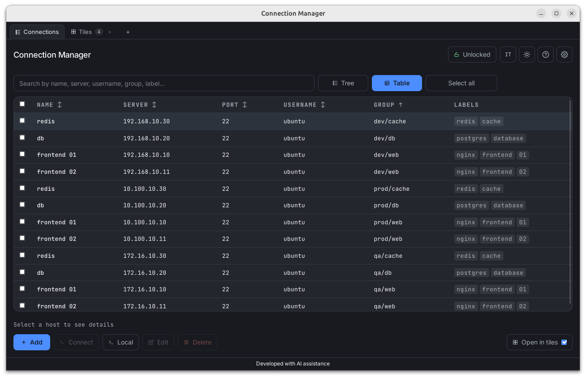

# Connection Manager

Connection Manager keeps all SSH connections organized in one place. Browse them in tree or table view, filter by any field in real time, import and export via CSV, and connect instantly: every session opens in its own **tab with an embedded terminal**, so you never end up with a pile of terminal windows. Passwords can be saved encrypted behind a master password.

---

## Screenshot



---

## Features

**Connections**

- Manage SSH connections with name, server, port, username and group
- Tree view grouped by environment and group
- Table view with sortable columns
- Real-time search across name, server, username, group and labels
- Import connections from CSV / export connections to CSV (passwords are never exported)

**Terminal tabs**

- Embedded SSH terminal in tabs (xterm.js + PTY): many sessions, one window
- Uses your system `ssh`, so keys, `ssh-agent` and `~/.ssh/config` work as usual
- Press Enter on an ended session to reconnect
- Optional: open a connection in an external native terminal ("External" button)
- Local shell in a tab: your own `$SHELL`, opened in your home directory ("Local" button, the `+` in the tab bar, or `Ctrl+Shift+T`)

| Shortcut | Action |
| --- | --- |
| `Ctrl+Shift+T` | New local shell tab |
| `Ctrl+Tab` / `Ctrl+Shift+Tab` | Next / previous tab |
| `Ctrl+Shift+W` or middle-click | Close the current tab |
| `Ctrl+Shift+C` / `Ctrl+Shift+V` | Copy / paste |
| Right-click in the terminal | Menu: Copy, Paste, Paste password, Select all, Clear screen |

**Saved passwords** (optional)

- Protected by a master password asked at startup, like KeePass
- Encrypted with AES-256-GCM, key derived with Argon2id and kept only in the backend's memory
- Typed automatically, once, only at the `user@host's password:` prompt of the right server
- On demand: right-click in an SSH terminal > **Paste password** types the saved password into the session (e.g. for `sudo`), without pressing Enter. It is decrypted and typed by the backend and never reaches the UI or the clipboard
- Bulk password change: search (e.g. by username and group), tick rows or whole groups, set the new password

---

## Requirements

- Linux (the embedded terminal also works on macOS; Windows is not supported)
- The `ssh` command available in your `PATH`

---

## Security notes

- Passwords are stored encrypted in the app's local storage; the master password and the key are never saved.
- If you forget the master password the saved passwords cannot be recovered. You can reset the vault (connections are kept).
- Whoever can use your unlocked session can use the saved passwords, as with any password manager.
- Prefer SSH keys when you can: they need no password at all.

---

## Install

```bash
curl -fsSL https://github.com/gsandrini/connection-manager/releases/latest/download/install.sh | bash
```

---

### Uninstall

```bash
curl -fsSL https://github.com/gsandrini/connection-manager/releases/latest/download/install.sh | bash -s -- --uninstall
```

---

## Tech stack

- [Wails](https://wails.io) - Desktop framework (Go + WebView)
- [Go](https://golang.org) - Backend logic
- [xterm.js](https://xtermjs.org) - Embedded terminal (bundled locally)
- [golang.org/x/crypto](https://pkg.go.dev/golang.org/x/crypto) - Argon2id key derivation for the password vault
- [creack/pty](https://github.com/creack/pty) - PTY for the SSH sessions
- [Alpine.js](https://alpinejs.dev) - Reactive UI (bundled locally)
- [Tailwind CSS](https://tailwindcss.com) - Styling (compiled locally)
- [Google Fonts](https://fonts.google.com) - Inter and JetBrains Mono typography (loaded from CDN)

---

## Built with

This project was built with the support of AI.

---

## Contributing

This repository is published for personal use / GitHub Pages only.
Pull requests and issues will not be reviewed or accepted.

---

## License

This project is licensed under the **GNU General Public License v3.0**.
See the [LICENSE](LICENSE) file for details.
